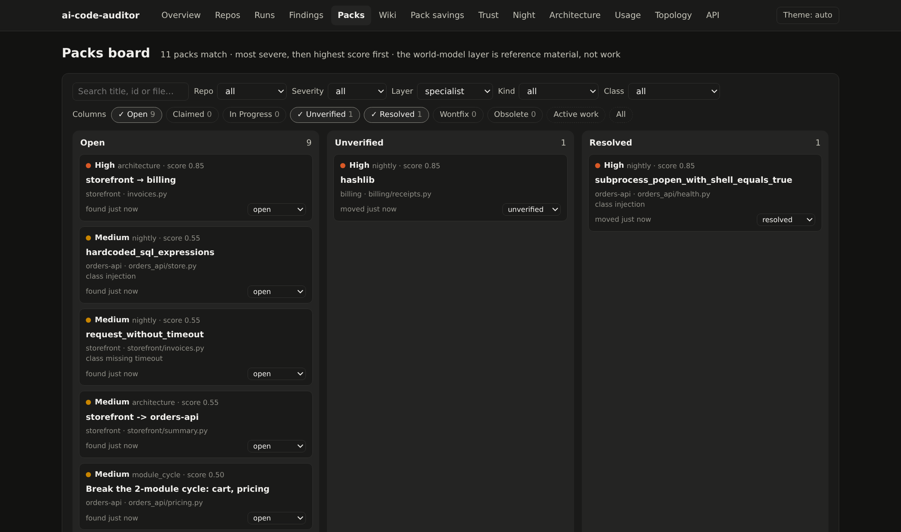
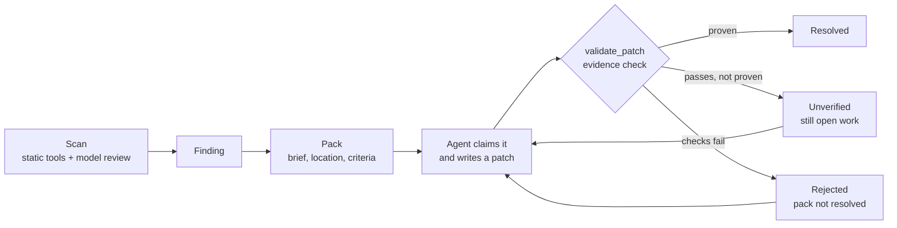
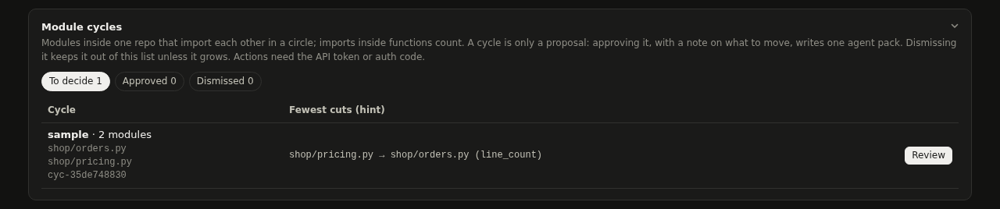

# AI Code Auditor

Scans a set of git repositories for bugs, security problems and structural drift, and writes each one as a work pack for a
coding agent. When an agent submits a code fix for a bug or security pack, validation resolves the pack only if the patch
includes a test that fails before it and passes after it, or a written waiver.



The board after scanning three invented repos with no model, with the module cycle approved by hand. The pages below are
real output from that scan ([script](scripts/build_example_reports.py)):

| Report | What it shows |
|---|---|
| [Patch validation](reports/examples/patch_validation.example.md) | Three patches: one resolved its pack with a failing-then-passing test, one stayed unverified for lack of a test, one was rejected for breaking a test |
| [Agent brief](reports/examples/agent_brief.example.md) | What an agent gets for one finding: the rule's fix, the file, the code and what counts as done |
| [Nightly findings](reports/examples/nightly_repo_report.example.md) | 8 findings: 2 high, 2 medium, 4 low, with file and line |
| [Security findings](reports/examples/security_report.example.md) | The 7 of those that are security findings, 2 of them only `assert` in tests |
| [Architecture violations](reports/examples/architecture_violations.example.md) | A UI importing its worker's package, and an HTTP call the rules don't allow |
| [Extraction candidates](reports/examples/extraction_candidates.example.md) | One function duplicated in two repos |

**Status:** runs nightly on one person's repos. The checked-in configuration is for that deployment, there is no packaged
release.

**Current results** (one deployment, 2026-11-23, `ai-audit eval trust`): 12 of 13 gates pass and one has no data (agent PRs
reverted, 0 of the 20 needed). 2.6% of 2,789 resolved issues came back; 2.5% of 2,394 resolutions in 14 days ran no tests
and 9.4% were waived. The exit criteria are not met. [Every gate, and what they don't prove](#how-it-checks-itself).

## From finding to resolved pack



1. **Scan.** Each night the configured repos are split into code units. Bandit and semgrep (when installed) and a model
   review them. Units that haven't changed come from a cache.
2. **Pack.** A finding becomes a pack: a short brief with its location, acceptance criteria and what "done" means.
   Findings are matched across runs by repo, file, type and title, so a re-found issue reopens the same pack.
3. **Patch.** An agent fetches a bundle for its repo, claims one pack and writes a fix. [AGENTS.md](AGENTS.md) has the flow.
   The night conductor can also open draft PRs.
4. **Evidence.** `POST /audit/validate_patch` applies the patch to a clean copy of the base branch and runs the project's
   tests there. Failures the base already has don't count against it.
5. **Close.** A bug or security pack needs a test that fails before the patch and passes after it. Other code changes need
   tests to have run. A pass without that is `unverified`. A written waiver can stand in for a test; it is recorded and
   counted.

Packs whose issue is no longer reported are closed as `obsolete`, which means "not seen any more", not "fixed". A scan
that couldn't review a file never counts as the issue being gone.

### In progress: module-cycle packs

A nightly scan finds Python modules inside one repo that import each other in a circle, including imports inside
functions. This is work in progress ([#154](https://github.com/smk762/ai-code-auditor/issues/154)).

| Part | State |
|---|---|
| Scan for cycles and private imports (`ai-audit structure`) | Working, Python only, no model calls |
| Evidence check: the cycle is gone, none was added or moved, and the tests ran | Working; piloted on one cycle in this repo |
| Approve or dismiss a cycle in the web UI; an approval must say what to move and creates one pack | Working, just added; too few packs to measure |
| Agent-proposed notes: an agent can suggest what to move, and a fresh, high-confidence suggestion fills in the approval note | Working, just added; a person still approves, and nothing generates proposals on a schedule |
| Suggested cuts | A hint only: in a hand-check all 13 cycles were real, but the suggested cut was in the right place for only 7 (public repos, 2026-11-24, [results](https://github.com/smk762/ai-code-auditor/issues/154)) |
| Packs for private imports | Not built: they can be judged, but nothing creates them |
| A CI rule that stops new cycles in other repos | Not built; this repo has its own test |

A pack resolves only when none of its members is in any cycle, so a partial fix to a large cycle stays unverified.



*Synthetic repo.*

## Quick start

This scans one small repo with no model, no API key and no services: results go to SQLite and files. It needs git and
Python 3.11 or newer. Installing uses PyPI; the scan makes no network calls other than one attempt to reach Redis on
localhost. Two things on your machine would change that: semgrep on
your `PATH` (the scan runs it), and a `GITHUB_TOKEN` or `GH_TOKEN` (the scan lists pull requests with it).

```bash
git clone https://github.com/smk762/ai-code-auditor.git
cd ai-code-auditor
python3 -m venv .venv && source .venv/bin/activate
pip install -e . bandit

# A workspace with its own config, and a repo with one planted problem
mkdir -p ../auditor-demo/config ../auditor-demo/sample && cd ../auditor-demo
cat > sample/app.py <<'PY'
import subprocess


def ping(host):
    return subprocess.call("ping -c1 " + host, shell=True)
PY
git -C sample init -q -b dev
git -C sample add .
git -C sample -c user.name=demo -c user.email=demo@example.invalid commit -qm init
cat > config/ecosystem.yaml <<YAML
repos:
  - name: sample
    path: $PWD/sample
    provider: local
YAML

export AI_AUDIT_LLM_CACHE_ONLY=1     # never call a model
export AI_AUDIT_PACK_RAG_INGEST=0    # don't send packs to a search service
export AI_AUDIT_TEST_ENV_CHECK=0     # skip checks for patch validation, which needs the API
export AI_AUDIT_LOG_LEVEL=ERROR
ai-audit repo-run
ai-audit packs
ai-audit packs --repo sample --bundle
```

`ai-audit packs` lists two packs, one for `shell=True` (HIGH) and one for the `subprocess` import (LOW). `--bundle` prints
the briefs an agent would get. Reports are in `reports/`. Two notices are
expected, about `JWT_SECRET` and `AI_AUDIT_PUBLIC_BASE_URL`: both are only for running the API. `ai-audit eval trust` will
show every gate short of data, which is right for a first run.

Use a fresh shell, or check that no `.env` sits in the clone: it is read automatically. To scan your own repo, change
`path` to its absolute path.

To add model review, use a local model with [Ollama](https://ollama.com):

```bash
unset AI_AUDIT_LLM_CACHE_ONLY
AI_AUDIT_LLM_PROVIDER=ollama AI_AUDIT_LLM_MODEL=<an installed model> ai-audit repo-run
```

or a cloud one, which sends the scanned code to that provider and costs money. Copy `config/generator.yaml` from the clone
into the workspace's `config/` first, then set `AI_AUDIT_LLM_PROVIDER`, `AI_AUDIT_LLM_MODEL` and the provider's API key.

Patch validation, nightly timers, Docker and several repos are in [docs/deployment.md](docs/deployment.md).

## What data leaves the machine

| Provider | Scan review | Night conductor |
|---|---|---|
| Ollama (local) | yes | with LiteLLM (`.[conductor]`) |
| Anthropic | yes, and half-price batches | yes (default) |
| OpenAI, xAI | yes | yes, also as fallbacks |
| Any OpenAI-compatible endpoint | yes | no |

The wiki builder and the finding classifier use Anthropic only. `AI_AUDIT_LLM_PROVIDER` picks the scan provider; the
conductor's models and fallbacks are in `config/generator.yaml`.

| Feature | What is sent, and where |
|---|---|
| Scan review | Each uncached code unit's source, its path, and a short description of the repo and its neighbours, to the scan provider |
| Night conductor, PR review | Findings, code and diffs, to the conductor provider. **With LiteLLM installed, a failed call is retried on the configured fallbacks, so code can reach a second provider.** Empty `fallbacks` to prevent that |
| Wiki builder | Source files and notes about them, to Anthropic |
| Finding classifier | Finding text, to Anthropic, only once a classifier prompt has been measured and frozen |
| "Ask" questions | The question and retrieved context (the wiki's pages and notes), to the scan provider |
| Draft PRs, PR intel, merge polling | Branches, PR text and API queries, to GitHub |
| Semgrep, if installed | Runs with `--config=auto`, which fetches rules from and reports metrics to semgrep.dev |
| Patch validation | Runs the patch's code and installs its dependencies, with network access. API keys and service URLs are removed from its environment, but it is not a sandbox |
| RAG ingest, webhooks | Packs, wiki text and status reports, to the URLs you configure. Pack ingest is on unless `AI_AUDIT_PACK_RAG_INGEST=0` |

With Ollama on localhost, scan review sends no code off the machine.

## Cost control

- **Ledger.** Each Anthropic call, and each conductor call, is recorded with its token counts and priced from a table in
  `auditor/spend_ledger.py`. A model missing from the table is charged at the dearest known rate. `ai-audit budget` shows it.
- **Lanes and caps.** Spend is split into lanes, each with a monthly cap set by `AI_AUDIT_BUDGET_<LANE>_USD`, under an
  overall `AI_AUDIT_BUDGET_TOTAL_USD`. The defaults are $190 in all: `audit` 15, `audit_batch` 100, `conductor` 80,
  `wiki` 30, `classes` 5 (the lane caps add up to more than the total, which wins). Other lanes have only the total.
- **Caching.** A unit is reviewed again only when its code, the prompt, the model or the effort changes, or its entry
  expires. Batches run at half price, and Anthropic prompt caching covers the shared context.
- **Pricing first.** `ai-audit repo-run --batch --estimate` and `ai-audit wiki build --dry-run` price a run without calling
  a model.

When a cap is reached: a synchronous scan falls back to simple pattern rules and records those files as unreviewed; a batch
submits only what fits; a conductor task fails and says why; a wiki build stops. Nothing closes as a result.

Caps cover Anthropic everywhere, and every cloud model in the conductor. Scan reviews by OpenAI, xAI or a compatible endpoint
are not capped or recorded. A cap is checked before each call, so calls
already running can take a lane slightly over it. Set a limit in the provider's console too.

## How it checks itself

Every gate has a threshold and a minimum sample. Below the minimum it reports `insufficient`, never a pass. The exit
criteria are every gate passing in two consecutive weeks and headline metrics not getting worse over four weekly snapshots.

One deployment, evaluated 2026-11-23 18:32 UTC. Source: `ai-audit eval trust` (`reports/trust_eval.json`, which is not
published). 12 gates passed and one lacked data.

| Gate | Value | Needs | Sample (minimum) | Result |
|---|---|---|---|---|
| Resolved with no tests run, last 14 days | 2.5% | ≤ 5% | 2,394 (20) | pass |
| Resolved on a waiver, last 14 days | 9.4% | ≤ 20% | 2,394 (20) | pass |
| Seeded bugs the evidence check proved | 100% | 100% | 6 (5) | pass |
| Cosmetic non-fixes wrongly accepted | 0% | 0% | 6 (5) | pass |
| Resolved issues that came back | 2.6% | ≤ 5% | 2,789 (50) | pass |
| Agent PRs reverted within 14 days | no data | ≤ 2% | 0 (20) | insufficient |
| Findings the next scan of unchanged code repeats | 89.4% | ≥ 85% | 7,981 (500) | pass |
| Obsolete packs that were reported again | 5.8% | ≤ 10% | 691 (20) | pass |
| Finding classifier precision, held-out labels | 95.3% | ≥ 95% | 86 (30) | pass |
| Finding classifier coverage, held-out labels | 86.0% | ≥ 80% | 100 (50) | pass |
| Lint rules correct on their fixtures | 100% | 100% | 11 (5) | pass |
| Architecture rules that fire on a seeded violation | 100% | 100% | 2 (1) | pass |
| Seeded instances a class guard catches | 100% | 100% | 15 (8) | pass |

The exit criteria were **not** met: neither of the last two weeks was fully green, and there were 2 of 4 weekly snapshots.

Why some resolutions ran no tests: all 60 were waivers, for 42 bugs, 17 security findings and one contract finding. In 58
the validator's environment lacked the project's dependencies (mostly machine-learning packages), and in two the defect was
in a test. (Read from the 60 packs' waivers, 2026-11-24.)

What each kind of check does not prove:

- **Trust metrics** show what happened after a resolution. An issue nobody reports again can still be there.
- **Minimum samples** stop a pass on too little data. They are not confidence intervals; 6 of 6 is weak evidence.
- **Held-out labels** are kept out of the classifier's prompt. Models being graded helped relabel them, so the scores
  measure agreement, not ground truth.
- **Seeded defects** are one-operator bugs that an existing test already catches. They test that the evidence check works,
  not that it handles subtle or untested bugs.
- **Evidence** shows that a test changed from failing to passing. It doesn't show that the test covers the whole issue.

How far the conductor may go rests on the same metrics. Every repo and finding class starts at draft PRs. It can be promoted
to ready-for-review PRs after 20 clean, evidenced PRs and 30 days, and a breach demotes it. Nothing merges automatically,
and changes to auth, secrets, migrations or data deletion stay draft PRs.

## Commands

Generated from `cli.py`; a test fails when they differ. `ai-audit <command> --help` lists the options.

<!-- cli:start (generated by scripts/update_readme_cli.py) -->
| Command | What it does |
|---|---|
| `ai-audit repo-run` | Run nightly repo audit pipeline |
| `ai-audit budget` | Show this budget month's Claude API spend by lane and model |
| `ai-audit ecosystem-run` | Run ecosystem audit pipeline |
| `ai-audit rest-run` | Night conductor rest session (scanners → Opus workers → draft PRs → status report) |
| `ai-audit ask` | Ask ecosystem copilot a question |
| `ai-audit search` | Semantic search over the audit RAG collection (wiki sections, packs) via rag-chat |
| `ai-audit qa-benchmark` | Run benchmark dataset for precision/recall |
| `ai-audit approve-extraction` | Approve an extraction candidate: writes its pack (same as the Approve button) |
| `ai-audit repair` | Run agentic repair loop via rag-chat repair API |
| `ai-audit diff-audit` | Audit only files touched by a diff |
| `ai-audit packs` | List/search agent packs (world model + specialist coding packs) |
| `ai-audit merge-refresh` | Lightweight merge-to-dev refresh: sync mirror → diff packs → RAG (debounced via API, or --now) |
| `ai-audit merge-poll` | Poll GitHub API for dev tip changes across mirrors; enqueue merge-refresh for moved SHAs |
| `ai-audit pr-intel` | Blocked-PR intel across mirrors: blockers, resolution path, spoken brief (read-only) |
| `ai-audit pack-savings` | Estimated token savings from agent packs vs crawling, per repo (tracked over time) |
| `ai-audit autonomy` | Trust-gated autonomy (#61): each (repo, finding class) level and why; --refresh moves them a step |
| `ai-audit revalidate` | Re-check merged fixes resolved on a waiver or left unverified; records stronger evidence, never demotes |
| `ai-audit test-env` | Can validate_patch run each project's tests? Collects tests in the validator's own envs, per repo (no tests run); reports missing test deps |
| `ai-audit structure` | Module cycles and private imports inside each repo's dev (report-only, no LLM) |
| `ai-audit eval` | Reliability evals (#63) |
| `ai-audit eval trust` | Gates for the trust upgrade: what passes, fails, lacks data, or isn't built |
| `ai-audit eval classes` | Score finding classifiers on the private gold set (#53) |
| `ai-audit pr-summary` | Commit trailers and the PR-body table for packs a change fixes (#73) |
| `ai-audit trust` | Trust metrics: false-resolve, reopen, recurrence, scan persistence, agent PR reverts (#52) |
| `ai-audit wiki` | Generated per-repo wiki (DeepWiki-style): build or show status |
| `ai-audit wiki build` | Build wiki pages (notes → drafts → check-and-fix) via the Batch API |
| `ai-audit wiki export` | Gated public bundle for dragonhound.dev (public argus repos only; no API spend) |
| `ai-audit wiki topology` | Gated public topology (JSON) for dragonhound.dev/topology/ (public repos only; no API spend) |
| `ai-audit wiki publish` | Commit the exported bundle to the private docs repo (bot identity) |
| `ai-audit wiki refresh` | Rebuild stale pages (weekly at most per repo), then export + publish |
| `ai-audit wiki ingest` | Send wiki sections to the audit RAG collection (rag-ingest) |
| `ai-audit wiki status` | Show built repos, their source SHAs and the wiki lane budget |
<!-- cli:end -->

## Limitations

- It is built around one deployment. Repo lists, service roles and scan context describe the author's repos until you
  replace them, and some features need companion services that aren't in this repo.
- Model review misses bugs and reports false ones, and repeated scans don't agree exactly.
- Patch validation covers Python and TypeScript/JavaScript. Where a project's tests can't run, Python falls back to lint and
  TypeScript is skipped; neither resolves a bug pack.
- Validation executes the patch. Run it only on code you would run yourself, or isolate the host.
- The structure scan is Python only, and the wiki builder reads only Python, JavaScript and TypeScript.
- Read-only API pages have no authentication. Don't expose the port.
- The metrics above come from one set of repos, with one person judging. Nobody has reproduced them.

## Docs

| Guide | What it covers |
|---|---|
| [docs/deployment.md](docs/deployment.md) | Patch validation, nightly timers, Docker, several repos |
| [docs/repair-quickstart.md](docs/repair-quickstart.md) | Generating, applying and pushing a repair patch |
| [docs/spec.md](docs/spec.md) | The product spec: what each part does today |

## Development

```bash
pip install -e ".[dev]"
python -m pytest tests/ -q
python scripts/update_readme_cli.py    # after changing cli.py
```

[CLAUDE.md](CLAUDE.md) lists the invariants and the test behind each. PRs go to `dev`.

## License

[MIT](LICENSE). Copyright (c) 2026 Dragonhound Labs.
